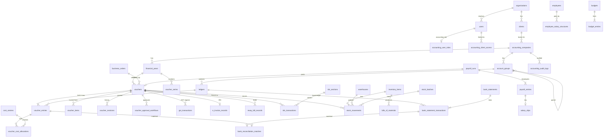

# Accounting & Financial Management module

A TallyPrime-style, double-entry accounting system inside Finpro AI for **Professional Users** (CAs, CSs, accountants,
financial consultants). A professional firm keeps separate books for each client; every client may have several
companies (sets of books). UI: **Accounting** in the professional sidebar (`/accounting`). API: `/api/accounting`.

## 1. Access model

| Who | Access |
| --- | --- |
| Professional User | The module. Without an explicit assignment a Professional User is an accounting **Admin** — the same trust the workspace already gives them (they can manage team members). |
| Finance User, Individual | No access (`403` on every `/api/accounting` route; menu hidden). |
| Platform Admin / Super Admin | These roles are described in `docs/BRD-HLD-LLD.md` but **do not exist in the codebase yet**. When they are added, give them read-only monitoring through `requireAccounting` in `server/src/accounting/access.mjs`. |

Accounting roles inside a firm (`PUT /api/accounting/roles/:userId`):

| Role | read | write (masters, vouchers) | approve (approve/reject, cancel posted, post payroll, file GST) | admin (settings, years, numbering, roles, backup/restore) |
| --- | :-: | :-: | :-: | :-: |
| Admin | ✓ | ✓ | ✓ | ✓ |
| Accountant | ✓ | ✓ | | |
| Reviewer | ✓ | | ✓ | |
| Viewer | ✓ | | | |

Non-admins can additionally be limited to specific clients (`clientIds`). Tenant isolation: every row carries
`organization_id`; company-level rows carry `company_id`; every route loads the company through
`loadCompany()` which checks both the firm and the client restriction, returning `404` for anything else.

## 2. Accounting rules

- **Money is exact.** Amounts are stored as `INTEGER` paise, quantities as thousandths, rates as basis points, FX as
  micros. APIs accept/return decimal strings (`"1234.50"`). Multiplication/rounding goes through BigInt with
  half-away-from-zero rounding (`server/src/accounting/money.mjs`). No floating point touches a ledger value.
- **Double entry.** Every accounting voucher must have ≥ 2 lines, each strictly debit or credit, totals equal and > 0.
  Payment must credit cash/bank, receipt must debit cash/bank, contra uses only cash/bank.
- **Statuses.** Draft → PendingApproval → Posted, or Rejected; Posted → Cancelled. Only *Posted* vouchers affect
  balances, reports, GST, TDS and stock.
- **Immutability.** Posted vouchers are never deleted (DB trigger). A change to a posted voucher stores the previous
  version in `voucher_revisions` (append-only, trigger-enforced) and keeps its number. The accounting audit log
  (`accounting_audit_logs`) is append-only (UPDATE/DELETE abort). Bank-matched or IRN-generated vouchers cannot be
  changed until unmatched / cancelled on the IRP.
- **Periods.** Financial years open automatically when the next consecutive year is first used; closed years and dates
  on/before the company lock date reject changes. Year close needs no closing entry: balance-sheet balances carry
  forward and the year's profit flows into *Profit & Loss A/c* in later years.
- **Numbering.** Per financial year × voucher type series (`INV/2627/0001`), automatic or manual, editable by Admins.
  Numbers are assigned on posting (pending vouchers get theirs on approval).
- **Stock in the statements.** With integrated inventory, opening/closing stock are valued from stock items (FIFO or
  moving weighted average); otherwise from manual closing-stock entries. Stock-in-Hand ledgers cannot be used in
  vouchers. The balance sheet reports any **difference in opening balances** instead of hiding it.

## 3. Features

**Masters** — 28 reserved groups (Tally structure) + custom sub-groups, ledgers with opening balances, party GST/PAN/
state, credit limit & days, bill-wise tracking, bank details, default GST rate/HSN, cost-centre applicability; CSV
ledger import; cost categories/centres; voucher numbering.

**Vouchers** — Journal, Payment, Receipt, Contra, Sales, Purchase, Debit Note, Credit Note, Stock Journal (transfer,
manufacture via BOM, adjustment), Delivery Note, Receipt Note, Payroll. Bill-wise references (new / against /
advance / on account), cheque/UTR details, cost-centre allocations, multi-currency header (currency + rate; invoice
lines converted to INR), credit-limit enforcement (Reviewer/Admin override), live posting preview, maker-checker
approval, recurring vouchers (weekly/monthly/quarterly/yearly, run on demand), document attachments, printable
invoices (HTML/PDF, standard / compact / detailed templates, amount in words), drafts.

**GST** — registrations, HSN/SAC with effective-dated rates, automatic CGST/SGST vs IGST from place of supply,
UTGST for UTs, cess, RCM (liability + ITC), ITC eligibility, unregistered/composition suppliers, B2B/B2CL/B2CS/EXP
classification, GSTR-1 (B2B, B2CL, B2CS, EXP, CDNR, CDNUR, HSN, documents), GSTR-3B (3.1, 4, s.49 set-off order,
cash payable), return snapshots + ARN, ITC register, liability summary, GST payments (optionally creating the bank
voucher), ITC set-off journal, GSTR-2B reconciliation (portal JSON or CSV), e-invoice IRP JSON (schema 1.1) with
validation + IRN recording, e-way bill payload + number recording. Portal/GSP calls sit behind
`gstPortalAdapter()` so a provider can be added without changing callers.

**TDS / TCS** — effective-dated sections with ledgers, rates, no-PAN rates and thresholds (seeded, editable), TDS on
purchase invoices and journals/payments, TCS on sales, deposit/challan tracking, deductee-wise quarterly summary.

**Inventory** — units (UQC), stock groups/categories, godowns, items (HSN, GST, FIFO / weighted average, reorder
level, opening stock, batch / expiry / serial tracking), purchase/sales integration, sales returns valued at cost,
transfers, BOM manufacturing, adjustments, negative-stock prevention, stock summary with godown split, movement
register, low stock, batch expiry, sales & purchase orders with fulfilment tracking.

**Reports** (all with date/FY filters, PDF / Excel / CSV export, drill-down to ledger → voucher) — Balance Sheet,
Profit & Loss, Trading Account, Cash Flow (direct method, reconciles to cash/bank), Trial Balance, Day Book, Ledger,
General Ledger, Cash & Bank books, Receivables / Payables with ageing, Expense / Income analysis (monthly), Financial
ratios, Cost centres, Budget vs Actual, Financial-year comparison, Stock summary / movements.

**Banking** — bank accounts, CSV/XLSX statement import with header detection and duplicate detection (fingerprints),
bank-charge detection, scored auto-matching (amount, date window, cheque/UTR, party name), rule-based posting,
manual match/unmatch, create-voucher-from-line, AI ledger suggestions, BRS (books ↔ bank with uncleared items),
saved reconciliations, manual clearing dates, cheque register (issued/received/cleared/bounced/stale).

**Payroll** — departments/designations, pay heads (fixed / % of basic, taxable, PF/ESI wage flags, proration, ledger
mapping), effective-dated salary structures, attendance and leave, monthly runs (proration, PF with wage ceiling,
ESI threshold, state PT slabs incl. February, TDS projection under new/old regime with 87A rebate & marginal relief),
posting a balanced payroll journal, salary slips (PDF), payroll register export, employee history. PF/ESI/PT/TDS
rules live in `payroll_statutory_configs` with effective dates — seed values only, never hard-coded in calculations.

**AI assistance** (assistive only — never posts, approves, files or certifies) — natural-language queries over the
books (the six example queries and more), duplicate purchase invoices, statistical outliers, s.40A(3) cash payments,
negative cash, round amounts, Sunday postings, missing narrations, expense spikes, ledger mismatches (TB, opening
difference, debtor credit balances, GSTIN/state mismatch, GST register vs duty ledgers), stale unreconciled bank
lines, risk score, statement explanation (deterministic, plus optional AI narrative), ledger suggestions, invoice
field extraction from text. Free-form questions fall back to the existing AI service when configured.

**Security & data** — RBAC, client restrictions, maker-checker, append-only audit trail with before/after
snapshots, checksummed company backup (JSON) and restore into a new company, import/export job history.

## 4. Database

Migration: `server/src/db/migrations/002_accounting.sql` (applied automatically at boot; `npm --prefix server run migrate`).
Existing tables are reused, not duplicated: `organizations` (the firm), `users` (professional profile = `users.role`
+ `professional_role`), `clients` (client organizations), `documents` (attachments).

New tables (58, plus 44 indexes and 6 integrity triggers): accounting_user_roles, accounting_client_access, accounting_companies, financial_years,
account_groups, ledgers, cost_categories, cost_centres, voucher_series, vouchers, voucher_entries,
voucher_cost_allocations, voucher_items, voucher_revisions, voucher_approval_workflows, recurring_vouchers,
closing_stock_entries, gst_registrations, hsn_sac_codes, gst_tax_rates, gst_transactions, gst_returns, gst_payments,
gst_reconciliations, e_invoice_records, eway_bill_records, tds_sections, tds_transactions, units_of_measure,
inventory_categories, warehouses, inventory_items, stock_batches, stock_movements, stock_transfers,
bills_of_materials, business_orders, budgets, budget_entries, bank_statements, bank_statement_transactions,
bank_reconciliation_matches, bank_reconciliations, bank_rules, cheque_records, payroll_departments, employees,
payroll_components, employee_salary_structures, payroll_statutory_configs, attendance_records, leave_records,
payroll_runs, payroll_entries, salary_slips, document_attachments, data_jobs, accounting_audit_logs.

Mapping to the suggested logical entities: chart_of_accounts / ledgers → `account_groups` + `ledgers`;
accounting_vouchers / journal_entries → `vouchers` + `voucher_entries`; gst_invoices / gst_itc_records →
`gst_transactions` (per voucher × rate, with ITC flags); stock_valuation → computed by the valuation engine from
`stock_movements` (not stored, so it can never drift); financial_reports / report_templates → computed reports +
`data_jobs` export log + invoice template JSON on the company; payment_records → payment/receipt vouchers +
`gst_payments` / `cheque_records`; payroll_deductions → lines inside `payroll_entries.lines_json`;
data_import_jobs / data_export_jobs → `data_jobs`.

Modified tables: none. Triggers: audit log append-only, voucher revisions immutable, posted vouchers undeletable,
cancelled vouchers final.



## 5. API (base `/api/accounting`, cookie session, JSON)

Firm level: `GET /me`, `GET /roles`, `PUT /roles/:userId`, `GET|POST /companies`, `POST /restore` (multipart backup).

Company level, prefix `/companies/:companyId`:

- Company & masters: `GET|PATCH /`, `GET|POST /financial-years`, `POST /financial-years/:id/close|reopen`,
  `GET|POST /groups`, `PATCH|DELETE /groups/:id`, `GET|POST /ledgers` (`?withBalances=1&search&kind`),
  `GET|PATCH|DELETE /ledgers/:id`, `POST /ledgers/import`, `GET|POST /cost-categories`, `GET|POST /cost-centres`,
  `PATCH /cost-centres/:id`, `GET /voucher-series`, `PATCH /voucher-series/:id`, `GET|POST /closing-stock`.
- Vouchers: `GET /vouchers` (`type,status,from,to,partyLedgerId,ledgerId,search,minAmount,page,pageSize,sort,dir`),
  `GET /vouchers/pending-approval`, `POST /vouchers/preview`, `POST /vouchers`, `GET|PUT|DELETE /vouchers/:id`,
  `POST /vouchers/:id/cancel|approve|reject`, `GET /vouchers/:id/revisions`, `GET /vouchers/:id/print?format=pdf&template=`,
  `POST /vouchers/:id/attachments`, `DELETE /vouchers/:id/attachments/:aid`, `GET|POST /recurring`,
  `PATCH|DELETE /recurring/:id`, `POST /recurring/run`.
- Reports: `GET /reports`, `GET /reports/:name?from&to&format=json|csv|xlsx|pdf` with names trial-balance,
  profit-loss, trading-account, balance-sheet, cash-flow, day-book, ledger (`ledgerId`), general-ledger,
  cash-bank-books, receivables, payables, expenses, income, ratios, cost-centres, budget-vs-actual (`budgetId`),
  fy-comparison, stock-summary, stock-movements. `GET /dashboard`.
- GST: `GET|POST /gst/registrations`, `DELETE /gst/registrations/:id`, `GET|POST /gst/hsn`, `GET|POST /gst/rates`,
  `GET /gst/gstr1?period&format`, `GET /gst/gstr3b?period&format`, `GET|POST /gst/returns`, `PATCH /gst/returns/:id`,
  `GET /gst/itc`, `GET /gst/liability`, `GET|POST /gst/payments`, `POST /gst/setoff`,
  `GET|POST /gst/reconciliation`, `GET|POST|PATCH /vouchers/:id/e-invoice`, `GET /eway-bills`,
  `POST /vouchers/:id/eway-bill`, `PATCH /eway-bills/:id`.
- TDS/TCS: `GET|POST /tds/sections`, `GET /tds/transactions`, `PATCH /tds/transactions/:id`, `GET /tds/summary`.
- Inventory: `GET|POST /units`, `GET|POST /inventory-categories`, `GET|POST /warehouses`, `PATCH /warehouses/:id`,
  `GET|POST /items`, `PATCH /items/:id`, `GET /items/:id/movements`, `GET /stock/summary|low|batches|movements`,
  `GET|POST /boms`, `GET|POST /orders`, `GET /orders/:id`, `POST /orders/:id/cancel|refresh`.
- Banking: `GET /bank-accounts`, `GET|POST /bank/statements` (multipart), `GET /bank/transactions`,
  `GET /bank/transactions/:id/candidates`, `POST /bank/auto-match`, `POST|DELETE /bank/transactions/:id/match`,
  `POST /bank/transactions/:id/ignore|create-voucher`, `GET|POST /bank/rules`, `DELETE /bank/rules/:id`,
  `POST /bank/apply-rules`, `GET|POST /bank/brs`, `GET /bank/brs/history`, `PATCH /entries/:id/bank-date`,
  `GET|POST /cheques`, `PATCH /cheques/:id`.
- Payroll: `POST /payroll/setup`, `GET|POST /payroll/departments`, `GET|POST /payroll/components`,
  `PATCH /payroll/components/:id`, `GET|POST /payroll/employees`, `PATCH /payroll/employees/:id`,
  `GET|POST /payroll/employees/:id/salary-structures`, `GET /payroll/employees/:id/history|preview`,
  `GET|POST /payroll/statutory`, `GET|PUT /payroll/attendance`, `GET|POST /payroll/leaves`,
  `PATCH /payroll/leaves/:id`, `GET|POST /payroll/runs`, `GET /payroll/runs/:id`,
  `POST /payroll/runs/:id/recompute|post|cancel`, `GET /payroll/runs/:id/register?format`, `GET /payroll/slips/:entryId?format=pdf`.
- Budgets, audit, AI, data: `GET|POST /budgets`, `GET|DELETE /budgets/:id`, `GET /audit-logs`, `GET /ai/anomalies`,
  `POST /ai/query`, `GET /ai/explain?narrative=1`, `POST /ai/suggest-ledger`, `POST /ai/extract-invoice`,
  `GET /ai/bank-suggestions`, `GET /backup`, `GET /data-jobs`.

Errors follow the existing convention: `{ error, details?: [{ field, message }] }` with 400/403/404/409.

### Voucher payloads

```jsonc
// Journal / Payment / Receipt / Contra
{ "type": "Payment", "date": "2026-05-25", "narration": "Rent",
  "entries": [ { "ledgerId": "…", "debit": "15000", "costAllocations": [{ "costCentreId": "…", "amount": "15000" }] },
               { "ledgerId": "…", "credit": "15000", "instrumentNo": "000451" } ] }
// Sales / Purchase / Debit Note / Credit Note — GST, round-off and entries are computed
{ "type": "Sales", "date": "2026-05-05", "partyLedgerId": "…", "placeOfSupply": "27",
  "items": [ { "stockItemId": "…", "ledgerId": "…", "qty": "60", "rate": "400", "discount": "5", "gstRate": "18" } ],
  "tds": { "sectionId": "…" } }
// Stock journal
{ "type": "StockJournal", "date": "…", "stock": { "mode": "Manufacture", "bomId": "…", "outputQty": "10" } }
```

## 6. Code map

| Area | Files |
| --- | --- |
| Engine | `server/src/accounting/` — `money`, `access`, `chart` (groups, FY, series), `tree`, `vouchers`, `stock`, `reports`, `gst`, `banking`, `payroll`, `inventory`, `intelligence`, `invoice`, `export` (CSV/XLSX/PDF/zip), `mappers` |
| Routes | `server/src/routes/accounting/` — `index`, `masters`, `vouchers`, `reports`, `gst`, `inventory`, `banking`, `payroll`, `misc`, `dashboard` |
| UI | `src/accounting/` — `AccountingWorkspace`, `context`, `components`, `VoucherForm`, `VoucherView`, `pages/*` |
| Tests | `server/test/accounting-*.test.mjs` |

## 7. Known limitations / next steps

- **No live GST/IRP/EWB/TRACES integration.** Returns, IRN and e-way bill payloads are prepared and validated; filing
  and generation happen on the portals (or a GSP to be added behind `gstPortalAdapter`). Finpro never files.
- **OCR** of scanned invoices needs an OCR provider; text-based invoices are parsed today.
- **Recurring vouchers** run when a user clicks *Run recurring* (no background scheduler yet).
- **Multi-currency**: voucher currency/rate and line conversion are supported; forex revaluation and realised/unrealised
  gain posting are not.
- **Payroll statutory seeds** (PF/ESI/PT slabs for MH, KA, WB, TS, GJ; FY 2025-26 income-tax slabs) must be verified
  by the professional and extended for other states; TDS on salary is a monthly projection, not a full Form 16 computation.
- **Payment reminders** are generated as text for the professional to send; no e-mail/SMS gateway is wired.
- **Platform Admin / Super Admin** roles do not exist in the app yet (see §1).
- SQLite is the store (as for the rest of Finpro); for large multi-firm production loads plan a move to PostgreSQL —
  the schema uses integer money and standard SQL to keep that straightforward.
